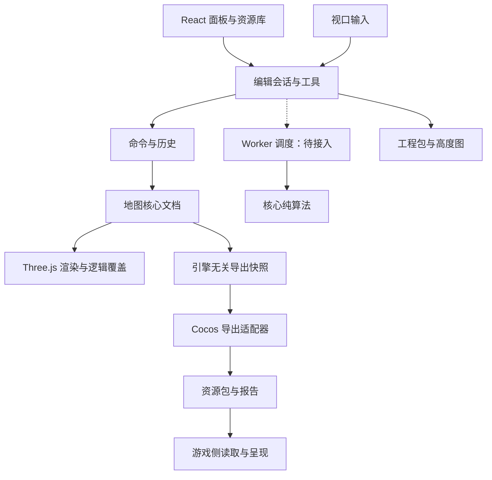

# 单片高度场、据点辖区与导出 · 技术设计

设计基线：0.5；当前实现与差距见[实施记录](implementation.md)。

关联：[资料索引](README.md) · [需求](requirements.md) · [操作设计](interaction.md) · [Cocos 导出](cocos-export.md)

本文为具体实现设计，不表示每个模块均已交付。实际实现与验证状态从资料索引查阅。通用架构和风格由规则文件约束，此处维护会变动的方案细节。

## 1. 技术栈与模块

TypeScript 严格检查；React 管理面板；Three.js／WebGL2 管理视口；Vite 开发和构建。Worker 重计算为待接入目标。PNG 编码支持真实 16 位灰度，ZIP 编解码落实输入预算；依赖版本由包声明和锁文件维护。

```text
src/core/           纯数据、坐标、命令、历史、草生成与归属校验
src/application/    编辑会话、工具状态机、异步调度
src/renderer/       单片地面、树草、水面、辖区覆盖与拾取
src/ui/             面板、资源库、列表、对话框
src/io/             工程包、高度图、通用导出快照与适配器注册
src/platform/       文件、输入、IndexedDB 适配
src/workers/        待实现：重计算入口，复用核心算法
editor-assets/      编辑器自带图标、默认地表 PNG、缩略图与来源记录
engine-adapters/cocos/ 数据协议接入说明与独立读取示例
dev-tools/          开发检查与资源加工工具
tests/              核心、浏览器及导出样例验证
```

以上是模块职责目录，实际代码与实现边界见资料索引。Unity／Godot 不创建空工程、空插件或占位导出实现。

### 静态资源、引擎适配与开发工具

- `editor-assets/` 是编辑器内置共享资源目录；`vite.config.ts` 的 `publicDir` 指向它，开发服务直接提供其中内容，构建时复制到 `dist/` 根目录。浏览器仍通过 `/surface/*.png`、`/favicon.svg` 访问（部署子路径时使用既有 base），不会多出 `/editor-assets/` URL 前缀；地图保存仍内嵌图片。
- `engine-adapters/cocos/` 保存数据包接入说明和独立 Node.js 读取示例；运行导出器与包校验位于 `src/io/`，通用包格式由导出协议维护。
- `dev-tools/` 只在开发和资源维护时调用：`check-unused.mjs` 审计源码引用，`prepare-surface.py` 将只读研究图集加工到 `editor-assets/surface/` 并更新素材描述。入口为 `npm run check:unused`、`npm run prepare:surface`；测试直接读取内置资源，不保存图片编码副本。

这三个目录均不作为正式地图作品库；完整目录树和素材加工链见[工程目录与职责说明](project-directory-guide.md)。



核心不引用 React、Three.js、DOM、Worker 或 Cocos API；渲染与引擎适配消费同一数据语义，不反向控制核心格式。

### 性能统计

- 左下性能浮层保持单行 FPS／Draw，追加模型面数；沿用每秒节流发布，React 不逐帧更新。`RenderStats` 只新增 `modelTriangles` 字段，初值为 0，显示按中文万／亿缩写。
- 渲染层的 `ModelRenderCounter` 只挂接树木、据点各 LOD 的颜色实例批次与草丛批次；在 `onBeforeRender`／`onAfterRender` 之间累加 `renderer.info.render.triangles` 的增量，兼容多材质组、drawRange、实例绘制及透明双面两次提交。保留原回调及其对象上下文。
- 主场景渲染前清零，按实际提交计数，不逐帧遍历模型实例，不修改渲染器全局统计重置策略。独立阴影批次、地形、水面、辅助图形、放置预览不挂接；隐藏、未提交或视锥外批次自然为 0，遮挡与片元透明不扣除已提交面数。
- 统计器由视口持有，回调随独占批次释放；异步 LOD 就绪后创建的批次使用同一统计器。地图文档、工程格式及模型精度不变。实际 WebGL 与界面验证见[实施记录](implementation.md)。

### 导航、资源面板与生命周期

- CameraRig 仅负责相机数学、投影、目标、方向与过渡；CameraNavigation 负责输入仲裁、捕获、按键状态和生命周期。EditorViewport 继续管理地图拾取与渲染，不把相机数据写入 MapDocument；已移除 OrbitControls 和重复输入处理。
- 方向与投影分别建模。切换投影通过目标距离与视场角换算正交尺度，轴向切换保留目标和半径，以四元数插值过渡。正交移动只使用相机平面，斜向飞行按时间推进并归一化对角方向。
- 导航按离散状态通知 React；姿态订阅直接更新 SVG 坐标系，不每帧刷新整个界面。失焦、隐藏、解除捕获与销毁均停止导航；编辑器与导航手势互斥，单面地形拾取拒绝背面命中。
- ViewportToolbar、OrientationGizmo、InputHints 分担显示、方向控制与有效提示；删除旧标签、下拉图层组件与相关孤儿样式。Modal 管理聚焦、Tab 循环和焦点恢复。
- VegetationPalette 管理分类、搜索、导入与资源选择；VirtualList 使用固定 64 CSS 像素行高、ResizeObserver 及上下各四行预取。列表行不创建 WebGLRenderer，不逐条加载模型；模型详情才创建独立预览。资源列表引用不随每次笔刷修订重建，避免滚动位置反复回到当前选择。
- EditorSession 保存两类笔刷资源及擦除模式，树木另有 paint／select 模式。选择资源不修改实例或历史；引用统计一次聚合。据点选择仅在据点工具中有效，渲染选中范围也遵守该上下文。
- ModelDetails 在工具内详情和全局资源管理器间复用；详情异步预览清理独立相机、渲染器和模型。ModelLibrary 按资源 ID／内容哈希缓存 Promise，共享并发解码；重建提交后清理不在文档中的缓存，迟到解码和过期候选批次均释放。Geometry、Material、Texture 和可关闭图像去重释放；重复 dispose 不重复释放。
- 导入记录 documentVersion；工程已切换的异步结果拒绝写入。资源增删属于命令，显示与临时选择不属于命令。工程格式、草分布算法及引擎适配接口保持原语义。

### 界面状态

- BrushPalette 复用 EditorSession 中的 terrainMode／surfaceLayer，通过既有通知更新界面，不创建另一份模式状态或新增地图命令。共享 Button 只在显式传入 active 时提供 aria-pressed；普通动作按钮不冒充切换按钮。
- 面板选中光感与地图浮层颜色在 CSS 变量中分别定义；地图浮层仅开启图标使用淡白蓝光晕，未修改 renderer、核心数据、工程格式或依赖。Slider 显示按实际参数值计算的进度，FPS／Draw 使用既有实时统计。
- 地图浮层单独使用 overlay 变量：工具条 #152424d9、FPS／快捷键 #182624b3，边框 #b2c2b62b；普通图标 #b5c6bf、文字 #c6d2cb、开启图标 #c5e5ff。仅活动图标使用 overlay-active-glow：2px #d3ebffcc／6px #b7dcfacc 两层 drop-shadow，选中悬停保持高亮与光晕，按钮与悬停背景透明，无选中方块阴影。kbd 保留语义，恢复 10px 字号、细边框、微弱底色和 2px 圆角小键帽。容器无阴影，提示背景模糊 3px，不设置整体 opacity，也不复用两侧面板选中填充。
- InputHints 根据实际雕刻模式和材质显示动作；平滑／定高不提示临时反向。快捷键保持单行，窄视口可在提示内横向滚动。
- 全局资源库打开时将资源类别与当前资源同步；宽弹窗按可用高度收缩，详情区域独立滚动，主要动作固定在详情下方。

## 2. 坐标、单片地面与地表

- Y 向上，XZ 为平面，米制，地面中心为原点。
- `index = row * samplesX + col`；`x=-width/2+col*width/(samplesX-1)`；`z=-depth/2+row*depth/(samplesZ-1)`。
- 图像左上对应 -X/-Z，图片右为 +X，下为 +Z；采样与导出参数明确记录方向。
- 单个 BufferGeometry／Mesh，固定 XZ，仅修改高度。513 档约 26 万顶点／52 万三角形，1025 档约 105 万顶点／210 万三角形。
- 脏区更新高度、邻近法线及包围体；局部计算与植被批次不拆分地面 Mesh。
- 拾取与贴地按实际三角面的重心插值，不与双线性高度查询混用。
- 平滑从同一输入快照读取邻域；连续笔刷按路径补点而非仅按帧采样。
- 四通道地表权重保持归一化，量化保存时保证通道总和一致；坡度／高度细节不反写权重。

六边形采用尖顶轴向坐标，`q=col-floor(row/2)`、`r=row`。格心换算为 `x=originX+sqrt(3)*radius*(q+r/2)`、`z=originZ+1.5*radius*r`，逆向使用立方坐标舍入并按行列裁边。逻辑网格与高度采样完全独立。

### 尺寸调整与网格

- 地面宽长为正整数米，每边最多 16384；采样数仍为 513／1025。coveringGrid 按范围、半径和既有 lattice 相位计算边界，偶数行偏移保留奇偶错列。重建通过旧格心 world→新 hex 映射 owners／Site，ID 和世界位置保留，q/r 可以重新编号。
- 新网格支持单边 2048、合计 1,048,576 格。矩形缓冲槽与实际地面相交判定分开，完全在外不可归属；Site 中心另要求在地面内。格线用线段裁切、填充用多边形裁切，避免边界外悬浮几何。
- prepareResize 产生候选 MapDocument 与 ResizeReport。高度采用原基础高度三角面采样，地表与草密度使用同一重心权重；高度／地表边缘延伸，草场外为零。校验、内存预算及文档／任务版本通过后，EditorSession 原子提交。
- 裁剪河流先使用当前可见中心线（原 Catmull-Rom 采样折线或既有 linear），按矩形逐段裁切、拼接连续内部段；首段保留 ID，其余新 ID。线性结果不再次平滑，clipped 允许河带截于地图边界。riverMesh 输出已裁切的位置和 UV，渲染与 Cocos GLB 复用，河床／植被使用相同 riverCurve 语义。
- 旧 v1～v3 ZIP 一律拒绝，不再执行网格或地表迁移。v4 备份恢复保留格心位置与归属；内部数据版本为 3，生成器和草分布算法版本未改变。
- History 普通操作保留稀疏差异；设置／网格结构变化使用完整紧凑数组快照。settings／grid 深拷贝，变长 owners 正确替换，单次超过 128 MiB 拒绝提交；撤销后 nextId 仍遵循不复用 ID 的约定。
- terrainRevision 区分地形变化与一般内容修订；普通格线单独缓存，选择、势力和归属显示重建 ranges，不重建格线。远景按屏幕格宽衰减线宽／透明度，地图范围变化同步水面裁切及相机近远面／雾。
- InspectorActions 为据点、植被、河流和势力的右侧固定区；河流的新建入口位于左侧河流列表上方，右侧保留编辑控制点与预览确认／取消；地形、地表模式由左侧 BrushPalette 提供，右侧只保留参数。MapOverview／MapOverviewInspector 分开显示摘要与尺寸表单；可滚动参数区在上下文变化时归零。showInputHints 仅是会话偏好，不进入 MapDocument 或 History。
- 正向坐标系用 SVG 方块、轴杆、锥形箭头及 XYZ 标签；姿态直接订阅，只有三个正向快捷接口。InputHints 不再接收全图回调，FPS／Draw 在视口左下独立显示，单行 InputHints 在右下显示，两者共享底部布局并保持间距，宽度不足时提示内部横向滚动，旧 caption／preview-bar／left-footer 样式清理。

### 四层地表材质

本轮按用户确认的本机研究范围使用已提取资源，不扩大公开使用或分发范围。四层顺序为草地、泥土、岩石、沙地；颜色来自两张图集的独立象限，分别重复 16／16／32／24 米。颜色亮度生成弱细节法线，仅为近似，不解码原游戏打包法线，也不改变网格高度。

- MapDocument.surfaceMaterial 独立于模型资源，包含材质包 id／version／source、四层颜色与法线的 SHA-256／尺寸／不可变 PNG 字节，以及 scale／detail／slopeRock。默认描述来自 editor-assets/surface 的 manifest.json 纯 JSON，应用层和 IO 负责装配与校验字节，核心不访问文件、DOM 或渲染器。应用启动先按分类清单并行读取模型、地表、水面和缩略图，再注册完整且通过校验的内置资源组，失败显示可定位的加载信息；PNG 不进入主 JavaScript。
- v4 的 map.json 保存层定义、显示参数和显式资源归属；PNG 按内容哈希保存，加载校验顺序、尺寸、64 MiB 解码预算、16 MiB 单图预算、SHA-256、PNG 块 CRC、RGB/RGBA8 格式及压缩数据完整性；不补齐旧工程，全部通过后切换候选工程。
- 渲染用 RGBA 权重纹理，在采样点对应纹素中心取样；图片行向下对应 +Z。颜色与法线采用世界坐标三向投射，保持单片 Mesh；颜色在线性空间混合，权重纹理不做 sRGB 转换。坡度显岩只派生显示权重，细节法线在 90～450 米间淡出，低频色调变化减弱重复。
- 材质滑块预览放在会话内，松手／键盘调参完成时一次提交；Esc、指针取消或失焦中断丢弃未完成预览。预览携带工程与内容版本，过期不提交。显示参数进入同一历史，PNG 字节不可变共享，不随历史深拷贝。
- 材质纹理按内容哈希和颜色空间引用计数；异步解码结果校验代次，过期或关闭后释放 Texture 与 ImageBitmap；已上传纹理在 renderer.dispose 前同步回收，关闭视口同时释放阴影目标并丢失独占 WebGL 上下文。地表涂刷和材质参数变化不重建高度网格；采样尺寸变化才更换权重纹理。
- 当前不实现自定义地表资源导入、八层权重、Cocos Effect 或材质烘焙。v2 导出包含地表参考贴图和权重；游戏侧材质由游戏自行实现，详见[通用协议](engine-export-spec.md)。

### 地表优化与开发缓存

本次属于所有地图共用的编辑器渲染能力优化，不制作新地图，不改变 v3 工程及 Cocos 导出。默认路径保留原纹理、4 倍各向异性过滤、三向投射、法线、阴影尺寸、像素比与地形采样数。

- `surface-shader` 保留原始对照与严格零贡献跳过两种着色路径。全部投射坐标及梯度在条件采样前生成，`textureGrad` 保持 mip／过滤有效；仅跳过严格为零的图层或方向。`SurfaceRegions` 用 32 个采样格一组的 RGBA 最近邻占用表，多覆盖一圈邻点，坡度显岩仍允许岩石参与。
- `EditorSession.subscribeRender` 发布工程版本、内容修订、变化类别与可选 XZ 范围；悬停及无关势力变化不触发重建。笔刷发送实际影响范围，撤销／重做、取消笔触和工程替换采用保守整体验证失效；失效状态不进入地图历史。
- 阴影图按需刷新。投影物异步提交、树／据点显隐、灯光或阴影参数、地形变化使阴影失效；草没有投影，不因草动画、纯相机移动或地表涂色重复生成阴影。实例提交同时校验地形代次，避免重贴地后沿用旧阴影。笔刷轮廓在位置、半径、格网及地形版本不变时复用。
- `SurfacePageCache` 是默认关闭的开发验证路径，仅通过视口构造选项 `surfaceMode: 'cached'` 使用；`original` 为原始着色／每帧阴影对照，默认及 `optimized` 为无损路径。界面没有新增按钮或性能参数。
- 缓存使用 256² 有效纹素、每侧 8 纹素过滤边界及两组 RGBA16F 数组纹理，分别存合成线性颜色与世界法线扰动；多分辨率由独立页面表达，不对数组生成跨页面 mip。只缓存着色数据，不拆分连续地形网格，光照、阴影、法线强度与距离衰减实时计算。
- 缓存总预算上限 256 MiB，包含两组页面和地形法线／高度输入纹理；容量从小规模按需增长、最多 128 页并按 LRU 淘汰，每帧至多生成一个页面（颜色和扰动两个输出）。片元按实际足迹检查分辨率和斜视条件，不满足时原始着色；无页面、过期、浮点目标能力不足或分配异常同样回退。页面生成恢复原渲染目标、视口、裁切及阴影脏状态，资源随视口关闭回收。
- 材质参数／资源或工程变化全量失效；涂刷按范围失效，地形变化另外覆盖法线邻点及过滤边界；更新期间走原始着色。页面不写入工程包、草稿或历史。

正式对照命令：`node tests/surface-performance.cjs --full`（先启动独立服务，可用 `EDITOR_URL` 指定）。覆盖启动地图及 513²／1025² 四层混合场景，近／中／远三档，预热后每档 10 秒、重复三次。GPU 查询按整帧汇总，包含当帧缓存生成成本。结果及固定时间的原版／优化版／缓存版截图写入 `test-results/surface-performance-report.json` 及同目录图片。启用门槛与实测结论见实施记录；缓存画面对照未通过时保持默认关闭，不以平均误差较小宣称无损。

## 3. 核心数据与唯一事实来源

- **MapDocument**：格式与生成版本、地图参数、网格参数、递增 ID、基础高度、权重、资产、树、草层、河流、据点、势力及逐格归属。
- **AssetDescriptor**：稳定资源 ID、内容哈希、类别 `city|fortress|tree|grass`、工程相对路径、缩略图、尺寸、面数、材质数、基础变换、贴地偏移及来源。
- **TreeInstance**：稳定 ID、assetId、XZ、实例旋转／缩放与随机结果；贴地 Y 和有效性派生。
- **GrassLayer**：稳定 ID、assetId、密度场、种子、生成版本、缩放／坡度／朝向设置、风动和显示参数。
- **River**：稳定 ID、有序 XZ 点、宽深水位、水面参数，可选 interpolation（默认 catmull-rom／裁剪 linear）及 clipped 边界标记。
- **Site**：正整数稳定 ID、`kind: city|fortress`、名称、assetId、中心 `{q,r}`、旋转、缩放、可空 `factionId`。两类据点使用同一 ID 空间，不互设隶属字段。
- **Faction**：正整数稳定 ID、名称、颜色；不持久化另一份成员数组或逐格势力归属。
- **cellOwnerIds**：长度 `columns*rows` 的 Uint32Array，0 为无归属，其余为 Site ID；是唯一逐格归属来源，包含受保护的中心格。
- **EditorSession**：工具、选择、预览、历史、任务和脏标记；会话状态不作为业务归属。

删除对象不复用稳定 ID，撤销与重做恢复原 ID；nextId 随工程保存。各据点格集合、势力成员及范围是派生索引，不能与数组并列成为可独立修改的数据。

## 4. 据点、辖区与势力算法

### 4.1 基本不变量

- 每个 Site 中心必须有效、互不重叠，中心对应 owner 必须等于该 Site ID。
- owner 的非零值必须引用存在的 Site；factionId 非空必须引用存在的 Faction。
- 中心格通过 Site 中心索引识别，不能把“已有 owner”的所有格子都当建筑。
- “额外辖区”是该 Site 所有归属格扣除自己的中心；允许为空和不连通。
- 势力范围通过 owner→Site→Faction 关系得到，模型或图层显隐不影响归属。

### 4.2 画刷与原子命令

HexTerritoryPaintCommand 使用半径 0～4 的轴向圆盘和连续路径插值。先裁边、跳过全部中心，再按模式处理：增加把 owner 改为选中 Site，擦除仅将选中 Site 的普通辖区改为 0。记录每格首次旧值和最终新值，双方索引与统计一起失效／更新。

ClearTerritoryCommand 只清除当前 Site 的非中心格。范围覆盖不弹逐格确认，但预览标明转移格数，整次拖动可撤销。辖区绘制不访问高度或水域合法性，不清除植被。

### 4.3 放置与移动

创建与移动先校验中心不被其他 Site 中心占用。普通辖区允许转为新中心，记录其原 owner；移动时旧中心设 0，新的中心 owner 设为当前 Site，其他辖区不平移。

原地确认提前判为 no-op，不能先清旧中心再误写归属。预览只使用候选状态，确认形成包含 Site、中心归属和被转移格的一个命令；取消不写正式数据。

### 4.4 删除与势力变化

DeleteSiteCommand 清除该 Site 的所有 owner 并删除 Site，历史记录完整恢复数据。AssignFactionCommand 只改 Site.factionId，owner 数组不变。DeleteFactionCommand 把所有相关 Site.factionId 置空并删除 Faction，整个操作可撤销。

### 4.5 查询与显示

- `getCellOwner(q,r)`：返回 Site 或空值，边界外为空。
- `getCellFaction(q,r)`：沿 owner 关系返回 Faction 或空值。
- `getSiteCells(siteId, includeCenter=true)`：返回确定顺序的轴向坐标，统计额外辖区时排除中心。
- `getFactionCells(factionId)`：派生并集，包含成员中心。

据点／势力覆盖使用独立贴地覆盖几何和轮廓，不修改地面材质；同势力相邻边不重复绘制，选中 Site 边界仍可突出。格线、据点范围和势力范围分别开关。模型选择与辖区画刷互斥，避免点击绘制时误切换 Site。

### 4.6 交互、拾取与显示

- 据点工具不再存在独立的 territory 顶层工具。编辑会话以 siteMode 表示选择、增加、擦除、放置、移动；放置和移动状态由模式派生，点击锁定标志只表达候选是否已确认选取。植被擦除参数不参与辖区绘制。
- 势力添加共用 factionMode：inspect／list／assign，移除独立列表开关；界面统一通过 setFactionMode 切换，不允许列表与地图同时激活。只有 assign 下的模型拾取调用分配用例，list 通过候选列表添加。成员变化更新据点 factionId；owners 不因势力分配而改写，撤销重做复用现有命令历史。
- 模式属于临时会话状态，不进入 MapDocument、工程包或 History；成员添加后保留模式，切换势力／工具、删除当前势力和 replace 时归 inspect。全局 Esc 在无弹窗和导航手势时允许从搜索框退出添加，先检查 isComposing 避免拦截输入法组词。
- 地面拾取在纯核心模块按射线顺序遍历高度场采样格，求每格两个三角面的最近交点；不再采用固定距离步进高度探测。渲染层负责画布坐标、相机矩阵和模型射线命中，过滤被地面遮挡的模型。
- 视口图层、势力属性、据点属性拆为独立组件，共用输入控件；逻辑覆盖构建、据点模型变换、地形拾取分别独立成模块。
- 所有 GLB 据点模型在模型库中包裹水平居中的渲染根节点，不改写工程中的原始 GLB。预览和正式对象复用相同位置、旋转、缩放方法；Cocos 导出使用同一模型库生成居中模型，按资源哈希和类别区分路径。
- 格线以 Three.js 自带 LineSegments2／LineMaterial 实现屏幕像素线宽；去重共享边并沿高度场细分，独立强调选中范围外边界。几何和材质由视口统一释放。
- TypeScript 开启 noUnusedLocals／noUnusedParameters；源码引用检查额外核对未调用导出、方法和不可达源码模块。独立读取示例作为包约定入口由集成检查验证，不以源码图误删。

## 5. 模型、树木与草丛

GLB 解析先验证静态模型、内嵌资源和预算，计算包围盒、面数、材质数及缩略图。assetId 与内容哈希分开：实例引用资源身份，原始内容可去重。资源基础变换与实例变换相乘，不通过导入时永久改坏原模型。

据点模型变化更新实际植被避让范围；它只是投影包围区域，不写入逻辑中心或辖区。树模型批量替换明确作用范围，使用一条可回滚命令处理资源引用及派生贴地。

树木实际随机结果持久化；多子网格按部件／材质实例化，不能把整个 glTF 场景当一个 Mesh。空间索引用于附近查询，独立于地面网格。

草密度场跟随高度采样分辨率，记录非负目标密度；一次手势合成密度后，按稳定世界候选位置、图层种子、整数哈希和密度接受规则生成。生成器有版本，候选不以相机帧或遍历顺序作为种子；水域、坡度及据点占用是派生过滤，不能反写密度。

每个可见范围生成相同的实例身份与变换，按固定优先级限制预算，离开相机后可丢弃渲染缓存，返回时恢复同一分布。风动固定根部，植被按资源、部件、材质和可见范围组织批次，地面仍一个 Mesh。

### 内置素材入口

这是共享资源与编辑器能力维护，不制作新地图。`editor-assets/models`、`surface`、`water` 各自持有 manifest.json，记录路径、哈希、尺寸、默认素材参数与来源；核心静态引用纯描述，不引入文件或网络 API。IO 的 builtin-resources 统一处理 base URL、整组校验、不可变字节共享和候选文档装配。GLB、PNG 不进入主 JavaScript。

- 八个模型：青瓦城池、山关要塞、山地松、山地阔叶树、翠柏、红枫、垂柳、原野草丛。要塞与草丛由开发工具一次性导出原程序几何，其余使用本工程 Blender 自制文件。ModelLibrary 统一解析文件，不保留程序模型回退。
- 原资源 ID 保留以供启动示例使用；不提供旧程序资源描述的迁移。模型和地表字节继续内嵌工程包，包内资源优先，水面仍为编辑器共享显示资源。已有通用工程版本读取逻辑未作扩展。
- 模型材质、阴影、水平居中与释放共用同一路径；实例树木继续使用 InstancedMesh。保持地图植被数量和 GLB 精度；LOD 设计见下节，游戏侧水面和地表效果自行实现。
- 测试初始化直接读取资源目录；删除原源码中的 PNG Base64 副本。地形、权重纹理、缓存和 shader 仍属于运行时算法。

### 清单开发服务缓存

清单文件路径和虚拟模块 ID 均使用 Vite normalizePath，确保 Windows 文件监听路径与模块图一致；热更新必须先使相应模块失效再执行整页刷新，不能只刷新浏览器。资源初始化验证默认地表材质参数，缺失或无效时在启动阶段报告对应清单。

### 内置模型 LOD

本轮仅优化内置模型显示、拾取和派生更新；原始 GLB、地图对象数量、地表与水面材质、像素比、抗锯齿、2048 阴影和连续地形算法不变。工程格式仍为 v3，Cocos 继续导出原始资源。

- 五种树木和城池由 `npm run prepare:model-lods` 离线生成两档 GLB，位于 editor-assets/models/lod。树冠按各材质的叶片连通分量计算面积和中心，再做空间聚类；代表叶保留原叶形与法线，以簇总面积补偿覆盖，避免随机删叶、整片裁冠和跨叶黑色大三角。枝干和建筑使用固定版本 meshoptimizer 的带 UV 约束减面。中／远景初始预算20%／3%，实际面数写入清单。
- models/manifest.json 为六种模型增加可选 lod 描述（sourceHash、两个文件／哈希／面数）；刷新清单仅保留源哈希匹配的派生描述，原模型变化后须重新加工。核心构造 ModelAsset 时剔除 file/lod，派生层级不进入工程包、草稿或历史。IO 仅对 ID 和源哈希均匹配的内置模型惰性读取 LOD，按部署 base 构造路径并校验哈希及静态 GLB。
- ModelLibrary 按 ID／源哈希／层级共享并发加载；各层级拥有自己的几何，共享原模型材质和纹理，重复解码图片立即释放。城池沿用原模型的水平锚点。加载失败保留已就绪模型并报告文件名，资源移除或视口关闭释放缓存及迟到结果。
- ModelBatches 用原模型包围球与实例变换计算屏幕直径：≥96 CSS像素为原模型，24～96 为中景，<24 为远景；15% 滞回。透视按相机空间深度计算，正交按 zoom 计算，选中实例及放置预览使用原模型。相机变化只复用和上传按资源／材质／层级组织的实例缓冲，不重新解析模型、生成植被或贴地。
- 128米空间索引仅服务模型候选与保守视锥裁剪，不拆分地形，也不为每株树创建节点。拾取先筛空间单元和包围球，再对候选当前显示几何做精确求交，返回文档稳定ID，并检查地面遮挡。
- 树木、草、据点分别维护失效键；RenderInvalidation 增加可选 models 分类，密度命令即使在其他工具中执行也可正确失效。相机移动草生成中心只重建草；据点范围变化重新检查树草避让。全量构建与草中心更新互斥，工程／任务代次拒绝过期提交。
- 阴影使用包含所有有效对象的独立稳定批次：内置高面数模型使用远景几何，其他模型保持原样。颜色通道实例按视锥裁剪，阴影批次不被观察相机裁掉；通过独立 onBeforeShadow/onBeforeRender 钩子仅向阴影通道提交实例。相机运动及显示LOD变化不重画阴影，投影对象、地形或灯光变化仍刷新。
- 开发构造选项 `modelMode: 'original' | 'optimized'` 只控制模型对照，默认 optimized，与 surfaceMode 独立；没有新增性能面板或地图参数。`test:model-lods` 验证编辑与固定画面，`test:builtin-performance` 对完整地图和简化地面的独立模型场景分别预热、每轮6秒、重复三轮；完整记录见实施记录与 test-results/model-performance.json。

## 6. 非破坏式河流

Catmull-Rom 平面曲线按弧长采样截面，统一水位；中心河床目标为 `waterLevel-depth`，岸边渐变到基础高度，只向下开挖。重算新旧影响区域并集，生成最终高度、水面、流动 UV 和岸边过渡。

校验名称、有限坐标、最小宽度、深度、水位／河床高度范围、越界和自身交叉；允许不同河流的影响带重叠。河带折叠与缺岸完整检查仍按实施记录列为差距。错误不提交，保留可修改预览。河道变化使对应法线、水面、树草贴地缓存失效，不改变 owner 或 Faction。

`riverConfluence` 使用 `riverMesh` 的真实裁切三角形，在候选替换旧位置后以包围盒及三角形分离轴判断接触，遍历得到完整连通组。EditorSession 原子提交候选与整组水位更新，按目标水位校验全部受影响河流；取消或失败不写入正式数据。改名不改变几何缓存键或地形修订。

`riverWaterMeshes` 按稳定 ID 排序，同水位河流的三角形通过半平面差集移除此前河流覆盖区，裁切交点插值 UV。外露河岸通过岸外侧对其他水面裁切得到，内部边不发亮；河带细分顶点携带岸距供网页着色。网页与 Cocos 共用覆盖区／裁切语义；网页调用可选的第三参数 `maxEdgeMeters=4` 额外细分，导出保持默认 `Infinity`，仍按河宽的一半细分。河流身份和原始控制点独立保留，连接关系与水面均为派生数据，不增加工程字段或版本。

### 浏览器水面材质

这是编辑器显示能力升级，所有河流共用一套内置样式；地图作者仍使用已有河道、宽度、深度和水位，不增加材质操作项或地图字段。`WaterSurface` 管理显示几何、水深与派生流向，`WaterMaterial` 管理共享材质、两张纹理、时间及异步加载；视口只协调更新、显示开关和释放。

- 资源工具从已有 `T_Mobile_River` 的 R 通道生成 512² 弱法线和碎纹遮罩，输出到 `editor-assets/water/`，记录来源与参数哈希。此通道仅选作视觉噪声，不声称还原原打包编码；原始独立水法线、泡沫与着色器未找到。
- 世界 XZ 波纹分为 24 米主波纹、8 米细波纹和 3 米近景微纹。主波纹包含值噪声解析梯度，不随距离归零；细波纹在 600～2400 米衰减，微纹在 160～850 米衰减并配合 mipmap。法线直接定义为世界向上，避免河带绕序引起二次翻转。既有灯光／标准物理材质提供高光；局部天空近似包含柔和明暗区域，通过反射方向产生波光，并限制掠射云层能量以保留水色；没有额外灯光、随机白点、场景倒影、折射或真实水流模拟。
- `createRiverFlowSampler` 从曲线节点的平滑切向派生视觉流向，按控制点先后定义方向；同水位交汇按距离和河宽加权，反向流可连续减速至零，不强制归一化造成跳变。水面顶点携带 `waterFlow` 属性；坐标／水位缓存只存在于一次几何重建中。默认视觉流速 0.8 米／秒，使用 12 秒双相平移交叉混合隐藏复位，避免流向变化区随总时间不断拉伸。流向不写回河流数据；v2 导出按水面顶点提供派生流向。
- 显示三角形最长边不超过 `min(河宽÷2, 4米)`。每个顶点按水位减最终地形高度生成非负水深；浅岸偏绿、深水偏蓝，透明度随水深变化。岸距转为米，只在外岸不足 0.9 米范围添加断续弱亮纹，交汇内部不产生亮边。
- 河道／尺寸改变重建水面；仅地形修订时复用几何和材质，更新水深属性。原始高度、权重、河流身份不被渲染回写；雕刻、撤销重做和工程切换均同步派生结果。
- 每个视口仅加载两张水纹，河流之间共享，mipmap 与重复采样开启。工程切换按几何键重建或复用水面，重建时释放旧几何；水面资源键包含文档贴图与材质描述，键变化时释放旧材质和纹理，避免使用上一工程资源。关闭时取消请求、释放材质／纹理／位图，迟到的解码结果关闭后丢弃。加载失败保留基础水面并提示，地图仍可编辑。

内部地图数据版本仍为 3；waterMaterial 显式记录资源归属，v4 备份收齐水纹原始字节并独立恢复，目录工程可锁定共享水纹；不提供自定义水纹导入界面。v2 导出水面几何、派生数据及参考材质参数，游戏侧自行实现水面效果；真实引擎运行尚未验收。

水流验收不能只比较 PNG 文件是否不同：测试以真实水面遮挡关系生成掩码，向内收缩两像素排除岸边，只统计水体内部亮度。固定时间稳定，间隔两秒至少 5% 内部像素亮度变化达到 6／255；另比较周期前后小时间步，排除复位闪跳。正常、全图、俯视及近远镜头均检查，并回放约八秒真实编码录屏；记录设备与运行帧率，不将可见变化当作性能达标。

### 地表与水面着色细节

本次只调整共享着色器，沿用既有 PNG、文档权重、水深、流向与全部地图参数，不改变资源哈希、工程格式或 Cocos 导出。

- 地表在三向投射前加入连续的小幅世界域扰动，不增加纹理采样次数；按原始权重混合草／土／岩／沙色调，叠加 127／43 米大尺度明暗。坡度显岩使用带轻微空间噪声的 `smoothstep`，细节法线按层限制强度。原始对照、严格零贡献路径与分页缓存使用同一颜色合成入口，缓存默认关闭的判定不变。
- 水面把法线噪声变换到顺流拉长、横流压缩的局部坐标，再转回世界方向；12／5.5／2.4 米纹理与 24 米解析噪声分层，保留 0.8 米／秒双相平移。颜色同时使用 17／5.5 米碎纹及不被 mipmap 平均的连续流线；俯视提高流线权重，弥补菲涅尔反射较弱的视角。
- 天空亮纹改为冷色、按距离限制能量，近景减少过曝，远景保留波峰层次；水深颜色、透明度和窄岸亮纹仍由既有属性驱动。没有场景倒影、折射、物理流体或几何波浪位移。

## 7. 历史、异步与资源

工具从 idle 到 preview/gesture，再 commit/cancel。画刷松开提交，模型／河道拖动确认后提交。历史记录修改前后值，范围转移、移动、删据点／势力整体入历史；上限见需求。

Worker 带文档版本和任务 ID，结果过期丢弃。大数组使用快照或局部差异，避免每帧全量复制，不逐帧推动 React 状态。关闭工程释放 GPU、位图、ObjectURL 和 Worker，共享资源按引用管理，历史仍引用的资源不能提前释放。

### 显示脏区与实例上传

`TerrainGeometry` 复用连续地面的索引、位置和法线；会话脏区合并至一次显示更新，法线扩展一圈，属性范围在实际上传回调清理。尺寸或采样变化、工程替换及未知范围全量更新，保守包围体包含文档允许的高度范围。模型批次按 LOD 缓存不可变实例槽位列表；仅在顺序／成员变化时重写对应矩阵，重建产生新的记录以覆盖变换变化。

新增开发对照 `performanceMode`：`baseline` 关闭本轮局部更新和上传去重；`candidate` 另启用共享地表梯度及内置合批。默认启用更新优化、关闭两项未达收益／画质门槛的候选；分页缓存仍默认关闭。合批缓存独立拥有几何与新增叶冠材质，不修改原始模型／LOD 或预览资源，所有层级按 ID／源哈希隔离并释放。完整行为、测试条件和取舍见 [第二轮渲染性能优化与验收](render-optimization.md)。

## 8. 工程格式与高度图

### 当前实现：v4 备份与目录工程存储接口

`.map3d` 采用 `formatVersion=4` 自包含 ZIP，内部地图数据仍为 3，生成器仍为 1。不再读取或迁移旧 v1～v3 包。包内 manifest、map、objects、共享锁、二进制数组及模型/地表/水面字节的完整契约见[工程规范](map-project-format.md#4-v4-自包含备份与资源契约)。

目录工程的编解码与平台无关存储服务已实现；共享引用显式锁定标识和哈希，自有资源使用内容哈希路径。备份恢复将包内资源标为工程自有，水面渲染和导出均从文档读取资源。失败候选不切换当前文档，不保存派生高度、缓存和撤销历史。

高程 PNG 使用真正灰度 16 位大端编码；工程 Float32 小端，不可混用。输出 `round((h-min)/(max-min)*65535)`，范围不够时提示修改而非静默截断；参数文件保存单位、尺寸、原点、采样和方向。高度图含烘焙河床而不含 Site、Faction 或 owner。

下载快照与当前编辑隔离，草稿通过 IndexedDB 适配；默认间隔和资源预算见需求，不把浏览器下载任务完成描述成已经验证磁盘文件。

### 目录存储与后续平台接入

`ProjectRepository` 已实现创建、打开、串行保存、新版备份/恢复、工程隔离草稿和可丢弃会话状态。`ProjectStorage` 要求适配器提供根目录隔离、预算读取、不可覆盖写和比较并原子提交入口；第 1 步以故障注入内存适配器验证，不包含真实桌面目录读写。

第 2 步增加 Electron 主进程、受限 preload、原生 ProjectStorage 适配及保存退出保护，详见[桌面开发](desktop-development.md)。首页、近期工程和完整创建交互仍属于[新版本计划](new-version-plan.md)第 3 步；不增加 Web 发布，MSI 在第 7 步处理。平台文件系统 API 不进入核心。

## 9. 导出与平台边界

运行导出采用 v2 数据协议，唯一来源见[通用协议](engine-export-spec.md)。ExportSnapshot 是内部隔离的文档副本、派生最终高度和坐标说明，资源字节沿用不可变共享；不暴露到 ZIP。导出选项含内容开关及可选 target／mode，默认 Cocos 和 production。返回字节、可读说明及结构化 ExportReport；校验失败抛出带路径／原因的错误，不修改地图或历史。

IO 直接编码标准 GLB，复用纯数据坐标／水面算法，不依赖渲染模型库、DOM、Three.js shader 或浏览器图片重编码。几何向量和法线计算使用 Three.js 数学类；原始模型不改写，据点仅增加水平居中包装节点。JSON 与权威数组只有一份，参考图片和材质与游戏对象逻辑分开；通过实际输出字节生成文件清单并在压缩前执行 Schema、字节与业务引用校验。

游戏自行读取、配置、替换资源和呈现；不交付 Cocos 场景生成器、导入映射系统、专有 Effect、覆盖层或双向同步。独立 Node.js 示例仅示范协议消费及高度／初始归属查询；引擎平台文件桥接不在本轮范围。UUID／Prefab 路径不进入通用包；内部地图数据版本仍为 3，工程备份为 v4。具体状态见[验收清单](engine-export-alignment.md)。

## 10. 实施验证与风险

包字段、完整包、独立读取、浏览器下载与真实引擎运行分层记录。验证矩形单片地面、两种采样、最终高度及 PNG16、只合成一次的变换、草依赖、中心保护与初始归属，并检查缺失／坏引用／坏哈希等失败路径。网页下载或 Node 示例通过不能代替 Creator 导入、游戏材质与性能；后者由游戏项目实测，本轮状态不得标为通过。
